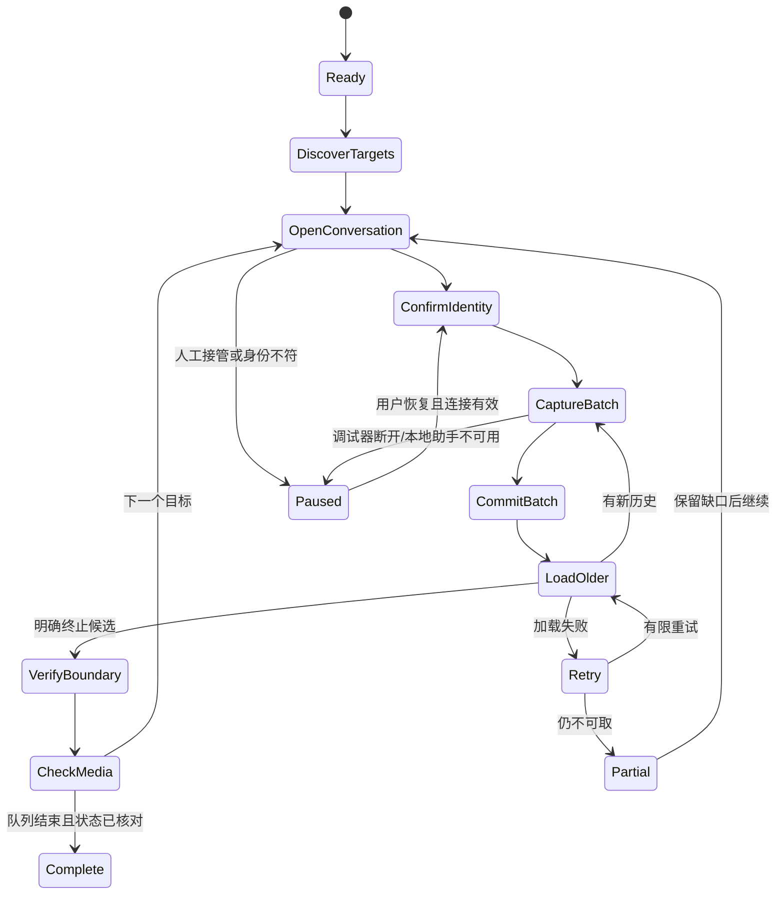

# 浏览器采集模块与任务协议

日期：2026-09-30。用于后续实现，当前没有应用代码。具体 SaleSmartly 路径、字段和选择器需由 P0 观察后填写。

## 1. 模块与目录

```text
D:\work\Salesmartly\
  apps/
    browser-helper/
      service-worker.ts      调试器事件、队列、native 连接
      content-controller.ts  页面身份与查看/历史加载动作
      panel/                 任务选择、进度、暂停与错误
    native-host/             本机管道接收、SQLite、媒体导入
    desktop/                 后续 Electron 本地界面
  packages/
    capture-protocol/        版本化批次与应答
    salesmartly-adapter/     响应解析、页面定位、资源关联
    archive-core/           标识、版本、事务、断点、队列
    media/                  下载、导入、刷新、校验
    export/                 HTML、JSONL、manifest
  tests/fixtures/           合成或脱敏样本
```

扩展最初提供 debugger、storage、nativeMessaging 与按需 downloads/scripting 等必要权限；实际 origin、CDN 与页面权限由观察确定，安装时解释用途。首版不需要导出整个浏览器 Cookie 或依赖 cookies 权限。

content-controller 的动作白名单：确认身份、打开会话、触发历史加载、打开/下载资源、检查加载状态、恢复先前视图。发送消息、结束/分配会话、标签/备注修改不进入此动作接口。

## 2. 原始响应与页面上下文

每个观测批次带有：

- schemaVersion、adapterVersion、jobId、batchId、captureSessionId。
- 实际标签页与 frame/target 来源、请求标识、采集时间。
- 已确认的项目/渠道/会话身份；响应自身的客户/会话身份优先。
- 响应正文、原始字段映射、历史边界/分页证据；不包含整份授权请求头。
- 截断、正文不可取、解析器不匹配、未识别类型等状态。

监听候选包括 Network.requestWillBeSent、responseReceived、loadingFinished、loadingFailed 与 webSocketFrameReceived。HTTP 消息正文在请求完成后及时读取；必要时处理相关 iframe/worker target，按实际运行时能力验证。事件名存在不等于数据一定可取得。

只为已识别的聊天响应调用正文读取，不复制全流量 HAR。资源请求记录必要的 URL、类型、响应状态、大小线索与消息关联；敏感 URL 的分享/日志版本脱敏。

HTTP 响应先筛选来源、确认类型，再解析，防止把广告/埋点响应当聊天数据。WebSocket 文本/二进制/压缩格式独立识别，未知格式保留有限的诊断状态，不按 JSON 强行解析。正文被回收时任务复查同一正常加载操作，不能默认为空列表。

## 3. 统一消息与附件模型

| 实体 | 建议字段 |
| --- | --- |
| account_scope | 本地 scope ID、项目、渠道账号、实际接入模式 |
| conversations | 客户稳定 ID、会话 ID、名称、覆盖类型、状态与映射来源 |
| messages | 本地 ID、来源稳定消息 ID、发送人、方向、类型、时间、内容、引用、状态 |
| message_versions | 来源消息 ID、观察时间、变化类型、原始记录关联 |
| observations | 采集批次、响应内身份、原始字段、解析版本与品质 |
| attachments | 消息 ID、附件序号、资源 ID/URL、原文件名、预览/原件品质、格式与状态 |
| assets | 附件 ID、大小、存储路径、文件格式与下载状态；旧 SHA 字段只为兼容保留 |
| capture_jobs | 范围、目标队列、任务状态、当前客户、最近提交批次与边界证据 |
| download_jobs | attachment ID、downloadId/传输 ID、暂存位置、尝试次数、失效刷新路径与错误 |

稳定键优先采用观察到并验证的源消息 ID，加项目/渠道账号与客户/会话范围。客户 ID 不能用姓名代替。缺少稳定 ID 时保留观察来源与关联候选，重复相同文字不能直接合并为一条；该类型的幂等能力须单独验证。

标准化字段不能覆盖原始响应。支持未知消息类型的原始占位；系统卡片、模板、贴纸、联系人、引用和撤回按样本增加解析器。通话日志不等于有可保存的通话录音。

历史客户消息与采集期间其他客户的新事件分开处理；任务范围之外的新事件不能被错误算入当前客户的历史完成数。

## 4. 任务状态机



历史完成需有终止证据；任务队列结束但媒体失败时显示部分完成。没有终止证据的会话保留“已采到范围”，不进入完整状态。UI 总进度来自目标任务清单；无法确认全部目标时不显示全账号完成百分比。

任务执行期间用户在目标标签页操作，或项目/身份变化时暂停。每次恢复重新确认身份和列表范围，不盲目续用旧 DOM 引用。定位失败时停止当前动作，不能降级为按坐标点击未知按钮。

## 5. 本机管道与确认机制

建议控制报文包括：

| 报文 | 用途 |
| --- | --- |
| Hello / Capabilities | 协议版本、助手状态、支持功能 |
| StartJob / PauseJob / ResumeJob | 任务范围与调度 |
| CaptureBatch | 原始与规范化记录，带唯一 batchId |
| BatchAck | SQLite 提交后的确认与断点 |
| MediaCandidate | 消息/附件与资源映射 |
| DownloadRegistered / DownloadFinished | 浏览器 downloadId、实际文件位置和状态 |
| AssetImported | 本地校验与导入完成结果 |
| ResourceRefresh | 重新打开对应消息取得新入口 |
| JobProgress / JobError | 覆盖、队列和需要用户处理的状态 |

Chrome Native Messaging 使用带长度的 JSON 消息，通过 stdin/stdout。助手 stdout 只写协议，日志走其他通道；报文按 UTF-8 字节计长度。

单批报文设计限制为较小尺寸，大批/二进制拆分，分块加传输 ID、序号与确认。不把数百 MB 文件 Base64 塞进一条消息。浏览器下载的大文件只传本任务文件信息，助手流式导入和校验。

SQLite 对 batchId 幂等确认：同一批次重复收到可返回已提交确认。先在同一事务写消息、观察记录、附件任务与批次断点，再返回 BatchAck。未确认期间不能推进历史页。

Native Messaging 断开后未确认队列保存到 IndexedDB，设置容量上限与背压。恢复时重发未确认批次；已提交批次不会产生重复。扩展全局变量不能作为唯一断点来源。

## 6. 媒体状态与恢复

状态至少区分：pending、fetching、browser_downloading、importing、complete、expired、unauthorized、unavailable、preview_only、unsupported_stream、failed。

v0.2 按附件 ID 与下载任务 ID 保存媒体，不做整文件哈希、内容寻址或跨消息字节去重。重复采集同一附件时复用已下载路径；实际资源变化则重新下载。导入成功后仅清理对应已注册任务的暂存文件，旧归档仍保持原路径。

下载器检查 HTTP/浏览器错误、文件是否存在、真实格式、实际大小，排除 200 返回 HTML 的情况。206 与视频分片需验证整体覆盖；未知总长度不能凭哈希声称原件完整。

失败时优先刷新对应消息的资源入口；存在可续传条件则续传，否则重新下载到新临时文件，不覆盖已校验资产。达到有限重试次数后保留缺口，允许用户后续重试。

导入时只处理与本任务 downloadId/传输 ID 对应的文件；确认落盘与数据库关联后才清理本任务暂存。用户其他下载不进入扫描、移动或清理流程。

## 7. 必要验证

- 真实样本中的稳定标识、长 ID、时间单位和多附件。
- 重叠历史、重复内容、迟到响应、会话身份切换。
- native 确认丢失、重复批次、助手/扩展重启。
- 历史到底、加载失败、缓存与解析失败的区分。
- Cookie/签名资源、过期刷新、错误页、原件与预览。
- 206/分片、Blob、受支持的完整音视频与大文件内存。
- 中文路径、磁盘不足、暂停恢复、可携带离线导出与 SQLite 备份恢复。

只为数据正确性和任务可靠性建立必要测试；页面定位器按实际截图/DOM与脱敏响应对照修复，不写与实现重复的模拟测试。
