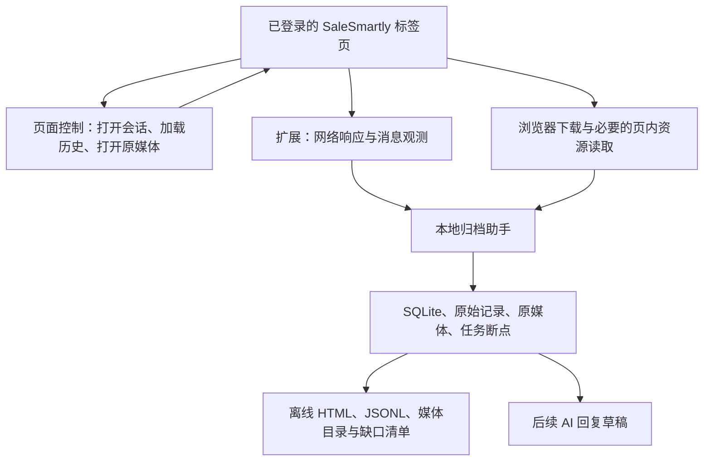

# SaleSmartly Pro 浏览器聊天归档开发计划

更新日期：2026-09-30，Asia/Shanghai。v0.2 批量、增量采集代码已实现，当前交付与限制见 [v0.2 说明](V02_BATCH.md)。以下内容保留早期路线背景，后续阶段不作为本轮已交付能力。

## 1. 已确定的需求与路线

用户已咨询 SaleSmartly 工程师，得到的答复是即使升级 Max，也无法保证通过 OpenAPI 下载对应语音、图片和视频。用户决定维持 Pro，并要求从浏览器交互层面规划采集与导出。

因此，主线调整为：已登录 Chrome → 页面交互驱动历史加载 → 采集网页获得的结构化消息与资源 → 下载原始媒体 → 本地归档与离线导出。

开放 API 权限、API Token、Max 升级和 webhook 不作为依赖。网页自身使用的消息/媒体请求属于当前登录会话的网页加载机制，需要现场观察；不套用开放 API 的字段、分页上限或 10 QPS 配额。

开发目标按顺序为：

1. 完整导出一个指定客户在页面可访问范围内的消息与原始媒体。
2. 扩展到所选项目、渠道、客户和时间范围，支持批量导出、暂停恢复和缺口报告。
3. Chrome 运行且登录有效时，采集新增消息；关闭或离线后通过网页历史补采。
4. 归档可靠后，接入 AI 回复草稿，保留用户确认发送的操作。

历史规模与 WhatsApp 具体接入方式尚未提供；默认先做历史导出，再做持续采集。

## 2. 推荐架构

采用 Chrome MV3 扩展 + Windows 本地归档助手。扩展复用当前 Chrome 登录会话，本地助手管理文件、SQLite 和导出；后续用 Electron 为本地助手增加界面。



| 层 | 责任 | 关键约束 |
| --- | --- | --- |
| 页面控制 | 遍历客户、打开会话、滚动/加载历史、打开附件 | 每次操作确认项目、渠道、会话身份；等待实际响应 |
| 网络采集 | 读取消息列表 JSON、必要的实时事件、资源信息 | 只采集选定标签页的聊天相关内容，保留来源与原始响应 |
| 媒体处理 | 原图、完整语音/视频、文件下载与失效重取 | 区分原文件、缩略图、预览、blob 与视频分片 |
| 本地归档 | 事务、去重、版本、队列、校验、断点 | 浏览器切换会话前先确认消息批次已持久化 |
| 导出查看 | 离线阅读、播放/打开、筛选、导出包 | 相对链接、可携带媒体、覆盖与失败清单 |

DOM 负责触发与识别界面动作；消息正文和标识优先来自网页实际收到的结构化响应。单纯抓当前 DOM 会遗漏虚拟列表、未加载历史以及资源信息。

## 3. 扩展与本机助手的选择

### Chrome 扩展

当前默认使用页面 Fetch/XHR 响应观察器，已在真实账号取得结构化消息；chrome.debugger/CDP 作为保留的高级观察方式。两种方式均复用已有标签页，无需给日常 Chrome 增加远程调试启动参数。

普通 webRequest 不能作为读取完整消息响应体的通用入口，也不能读取已建立 WebSocket 的每条消息。调试器附着前已经加载的内容可能没有可取的响应，因此先开始观察，再触发样本会话与历史加载；对现有草稿不自动刷新页面。

人工验证时可使用 DevTools Network 查看请求；扩展调试器工作时打开同一标签页的 DevTools 可能终止附着，任务应暂停、保存断点并显示原因，不能静默继续。

### 本地助手与通信

P0 先用 Node.js + TypeScript 本地助手，通过 Chrome Native Messaging 接收批次、记录任务和导入媒体。通信通过本机进程管道，不需要本地 HTTP 服务或公网端口。Windows 安装阶段注册当前用户的 Native Messaging host，并将 allowed_origins 限制到本扩展 ID。

大消息分批传输，媒体优先下载到磁盘再由助手导入。消息采用版本、批次 ID、确认应答和重试，助手提交 SQLite 事务后才应答。扩展保存未确认批次；助手断开、队列超限或浏览器重启时停止驱动下一页，恢复后重复确认并继续。

后续增加 Electron + React + TypeScript 界面，提供目录选择、进度、搜索和离线查看。SQLite 驱动在实现时核对目标 Node/Electron 支持与打包能力，不为规划阶段安装多套运行环境。

### 本机已有环境

上轮只读检查：Windows x64、Node.js v24.13.0、npm 11.6.2、Python 3.12.7、Git 2.52.0.windows.1、Chrome 153.0.8010.53。D 盘当时剩余约 212.4 GiB；这些是检查时的状态，实际开发与批量下载前再确认容量。

代码位于 `D:\work\Salesmartly`。归档目录由用户选择，代码、客户数据和导出副本分开保存。

## 4. 两种采集模式

### 手动观察模式：第一个交付

用户选定 SaleSmartly 标签页并开始观察，手动打开一位客户、加载几段历史、打开图片/语音/视频。扩展记录相应结构化消息，建立消息与附件关系，保存完整原文件，并生成单会话离线样本包。

这个阶段先回答四件事：页面怎样取得历史、哪种标识可以稳定对应消息、原媒体如何取得、较早消息能否访问。避免还未理解页面机制就加入复杂点击循环。

### 批量历史模式：观察结果确认后实现

先枚举目标客户/会话并建立本地任务清单，再按顺序打开客户、确认范围、分段加载历史、持久化消息、处理附件和记录覆盖状态。

第一版由正常网页交互触发历史请求。后续如果实测表明可以在同一登录页内安全复用已观察到的只读分页机制，再考虑提高效率；内部请求地址、参数、认证和限制必须来自观察，不能猜测，也不能扩大账号可访问权限。

默认一次处理一个会话、有限媒体并发，每一步等待响应与本地提交。失败退避、暂停和重新登录恢复，不使用开放 API 的 QPS 数字作为网页调度依据。

## 5. 历史采集流程

1. **固定任务范围。** 选择项目、渠道账号、客户范围、日期与归档目录，记录任务启动时间作为新增消息的划分依据。
2. **枚举目标。** 检查客户列表、聊天列表以及可访问的已结束会话等入口。页面各筛选结果合并为唯一客户/会话清单；发现的数量与分页边界记录在报告中。
3. **打开并确认。** 页面显示的身份与网络响应中的身份一致后，才能开始写入该会话。客户历史与单次会话记录的覆盖范围分开标记。
4. **采集当前批次。** 读取聊天 JSON/事件，保存消息标识、发送人、时间、类型、引用、状态和可取得的原始字段。
5. **加载更早记录。** 找到实际聊天容器的历史加载机制，滚动到顶部或使用加载入口；不是滚动整张网页，也不按屏幕元素数计数。
6. **持久化再前进。** 本地提交本批消息、附件任务与断点后才加载下一批。优先及时处理会失效的媒体链接。
7. **确认历史边界。** 使用实际分页终止信息、明确最早提示或复核请求判断。连续几次没有新 DOM、超时或空白页面均不能单独证明历史到底。
8. **检查附件和覆盖。** 不可取得的项目保留失败原因和重试入口；结束该客户后记录最早/最晚时间、消息与媒体数量及缺口。
9. **继续队列并复查。** 处理下一客户；对枚举期间改变顺序、新增会话、重叠页和已中断任务再次核对。

若当前页面没有可靠总数或终止信息，报告“已采到的历史边界与证据”，不能显示全账号 100% 完整。只有证明单客户全历史可遍历后，才能扩展批量宣称。

## 6. 原媒体下载方案

| 实际资源形态 | 处理顺序 | 如何验收 |
| --- | --- | --- |
| 普通 HTTPS 资源 URL | 由本地助手尝试流式下载；需要登录态时使用浏览器下载 | 保存实际文件、校验格式/大小、断网打开 |
| 带签名的短时 URL | 获得后尽快下载，失效后回到同一消息重新获取 | 刷新成功后保存原文件，失败保留原因 |
| 浏览器 Cookie/其他授权限制 | 使用 chrome.downloads 或网页自身的下载入口；必要时在创建资源的页面环境读取 | 不假设把 URL 拷给 Node 就能成功 |
| 普通 Blob 文件 | 在所属页面上下文中读取或触发页面下载，必要时分块传本地助手 | 证明字节是完整原文件，不能由 Node 直接请求 blob URL |
| 视频 Range / 206 | 优先发起完整文件下载，核对总长度与完整内容 | 一段播放响应不算完整视频 |
| HLS/DASH/MediaSource | 单独验证完整清单、分片与封装方式，再决定是否增加处理模块 | 不把播放缓冲片段算成完整素材；仅此类样本通过后才声称支持 |
| 缩略图或压缩预览 | 打开原媒体或使用页面下载入口取得较完整资源 | 记录资源品质；拿不到原件时标记仅预览 |

chrome.downloads 的 HTTP/S 下载使用对应主机的当前 Cookie，但额外授权、站点资源约束与具体文件依然需要实测。下载文件名是相对于 Chrome 下载目录的路径，不能直接指定任意 D 盘绝对路径。因此：

- 浏览器先下载到专用任务暂存子目录。
- 监听下载完成，记录 downloadId、实际路径、消息/附件任务关联。
- 本地助手确认文件完整，校验后导入用户选择的归档目录。
- 导入确认后才允许清理本任务暂存文件；不改变用户全局下载目录，不处理其他下载。

大视频采用浏览器下载或本地流式下载，不通过 CDP getResponseBody 将整个视频搬进扩展内存。创建 Blob/分片读取时也需要分块、确认和背压。

按用户最新要求，不采用整文件 SHA-256 校验或内容寻址文件库。下载完成后检查文件存在、非空，读取少量文件头防止把登录页当素材。媒体按附件和下载任务 ID 命名；旧文件名及引用保持兼容。重复消息按平台 ID 去重，同一附件的已下载文件直接复用。

## 7. 标识、数据模型与断点

数据模型与来源字段见 [浏览器采集规格](BROWSER_CAPTURE_SPEC.md)。关键要求：

- 使用实际观察到的稳定消息 ID，并按项目、渠道账号、客户/会话范围验证唯一性；时间和文字相同不代表同一条消息。
- 切换会话时仍可能收到旧会话的响应或其他客户的实时事件，按响应内身份归属，不按当前屏幕强行归类。
- 长 ID 以字符串保存，必要时使用保留整数精度的 JSON 解析。
- 原始消息响应、规范化消息、附件任务和采集批次关联保存；不记录整份 Cookie/Authorization 或整个浏览器网络历史。
- 修改、撤回保留观察到的版本；未加载的旧内容变化与停机期间的删除不能承诺全部发现。
- 浏览器/扩展侧只留必要的未确认队列，SQLite 持久化为主。MV3 service worker 状态不能只存在全局变量里。
- 重启后重新打开目标会话，重复采集断点附近一批并去重，再继续加载；过期的分页 token 不能被假定仍有效。

状态至少区分：等待、采集消息、等待历史加载、处理媒体、已采到历史边界、部分失败、需要重新登录、用户暂停和解析器不匹配。消息覆盖、历史边界与媒体完成率分别显示。

## 8. 导出交付与用户操作

第一版界面操作建议：

```text
选择 SaleSmartly 标签页
选择 当前客户 / 已勾选客户 / 所选范围
选择 导出时间与保存目录
开始 → 查看消息进度、历史边界、媒体结果
暂停 / 恢复 / 重试缺失素材
打开本地档案 / 导出可携带副本
```

历史导出会切换会话并触发媒体加载，建议指定一个采集标签页；实际需要的可见/前台条件在 P0 测试，不承诺隐藏后台永久无人值守。用户在采集页操作或切换项目时，控制器暂停并重新确认身份。

打开会话可能触发平台已读或读回执，需要样本验证并说明。页面控制动作仅包括导航、查看、历史加载与媒体下载；不发送消息、不点击分配/结束会话、不修改备注或标签。

导出包建议：

```text
exports/<客户稳定ID>/
  conversation.html
  messages.jsonl
  attachments/
  manifest.json
  missing-media.csv
```

HTML 显示客户、渠道、发送人、时间、文字、引用关系，以及图片/音频/视频/文件的本地入口。文本进行转义，卡片按已知结构渲染。媒体路径相对，复制整个导出目录到另一台电脑仍可使用；浏览器不支持的编码提供原文件入口。

manifest 包含账号范围、日期、采集时间、历史边界证据、消息数、预期附件数、已保存数、哈希和缺口。缺失素材保留占位，不把失败项从分母移除。

数据库/媒体存储与导出副本分开管理。容量估算纳入大视频、暂存、导出副本和余量；磁盘不足前停止新下载。SQLite 使用一致性备份并实际验证恢复。

## 9. 开发顺序与粗略工作量

粗估针对一个开发迭代，不含用户验证等待和批量媒体下载耗时；P0 后重新估算，不承诺未观察的页面可以自动完整遍历。

| 阶段 | 工作内容 | 交付与通过条件 | 粗估 |
| --- | --- | --- | --- |
| P0 | 扩展观察器、本地助手、手动样本采集 | 真实消息结构、原图/语音/视频/文件保存且离线可用；能取得较早样本并说明历史加载机制 | 2–4 个工作日 |
| P1 | 单客户历史自动加载、去重、媒体队列、单客户导出 | 已加载多批消息逐条一致；能可靠判断边界；断点恢复和媒体匹配正确 | 3–5 个工作日 |
| P2 | 客户/会话枚举、批量队列、失效刷新、异常重试 | 长历史、多渠道、结束会话、中断、身份切换与缺口报告通过 | 4–7 个工作日 |
| P3 | Electron 界面、Windows 安装、本地检索与备份 | 不依赖开发终端；扩展和 native host 稳定连接；可携带导出与恢复通过 | 3–5 个工作日 |
| P4 | 新消息采集与重开追平 | 登录有效时捕获新事件；重开可补页面可得历史，缺口可追踪 | 2–4 个工作日 |
| P5 | 当前客户上下文与 AI 草稿 | 归档稳定后另行估算；不把历史回填误当新消息，也不自动发送 | 后续独立安排 |

归档版本暂预留约 3–5 周；内部机制变更、缺少稳定标识、无法枚举全部客户或分片视频会影响范围。发现这些情况时明确缩小到已证明可取得的数据，而不是先把界面做完。

## 10. 下一开发迭代的具体交付

第一迭代实现“浏览器观察与单会话导出 PoC”：

1. Chrome MV3 扩展：选定标签页、开始/停止观察、记录聊天相关响应、显示当前身份与消息类型。
2. Node/TypeScript native host：接收批次、确认落盘、记录下载关联与错误。
3. 原媒体获取：先支持常见 URL + 浏览器下载，Blob/分片按实际样本决定增补。
4. 导出：一个客户的 HTML、JSONL、原媒体与 manifest。
5. 能力矩阵：每个实际渠道分别记录已验证类型、历史范围、未支持类型和失败原因。

P0 验收表见 [可行性清单](FEASIBILITY_CHECKLIST.md)。首阶段不开发完整批量调度、模型接入或真正嵌入 SaleSmartly 的桌面壳。

## 11. 维护、运行条件与后续 AI

页面解析器与 DOM 定位器单独版本化。页面结构或响应结构不匹配时保存必要证据、暂停相关任务并提示修复，不能把解析失败当空历史。优先用稳定身份、角色/标签、已观察的属性定位，避免只依赖容易变化的 CSS 类名。

浏览器关闭、登录过期、睡眠、调试器解除或网络断开时停止观察；再次启动按断点补采。网页已失效、服务器已删除、无法解密或从未同步的媒体记录为无法取得，不能保证恢复。

AI 接口使用本地归档的新客户消息事件、当前会话映射和必要上下文；历史回填不触发草稿。连续新消息合并、客服已回复或会话已改变时检查草稿有效性。第一版以复制/插入草稿为交付。

## 12. 资料与验证状态

本轮使用 agent-reach 的 Exa 搜索，并核对以下 Chrome 官方资料。SaleSmartly 的内部路径、消息结构、媒体授权与历史范围仍未实测，不由这些通用文档推导。

- [Chrome debugger](https://developer.chrome.com/docs/extensions/reference/api/debugger)：标签页附着、权限、网络观测与解除事件。
- [Chrome webRequest](https://developer.chrome.com/docs/extensions/reference/api/webRequest)：网络事件能力边界，含 WebSocket 内容限制。
- [Chrome downloads](https://developer.chrome.com/docs/extensions/reference/api/downloads)：浏览器下载、Cookie、路径与下载状态。
- [Native Messaging](https://developer.chrome.com/docs/extensions/develop/concepts/native-messaging)：本机管道、host 注册与报文限制。
- [MV3 service worker 生命周期](https://developer.chrome.com/docs/extensions/develop/concepts/service-workers/lifecycle)：持久化状态与意外终止恢复。
- [DevTools 网络扩展](https://developer.chrome.com/docs/extensions/reference/api/devtools/network)：人工观察与 getContent。
- [CDP Network 协议](https://chromedevtools.github.io/devtools-protocol/tot/Network/)：实现时核对实际 Chrome 支持的命令和事件。
